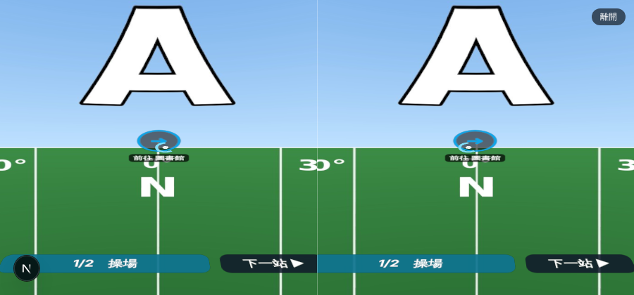
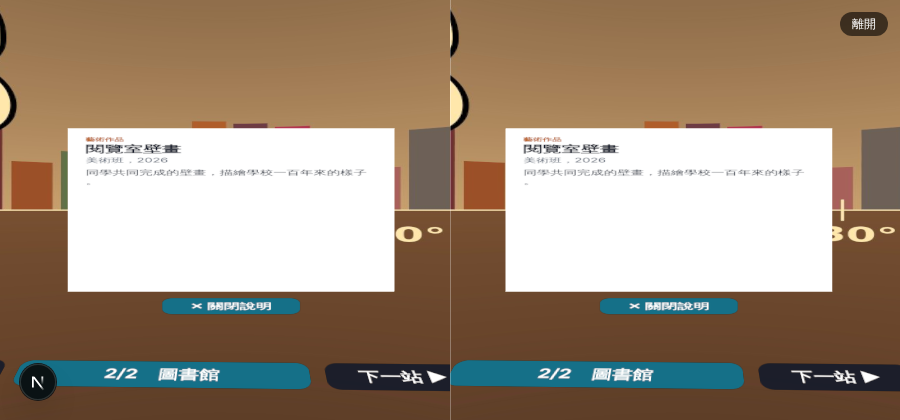

# VR 眼鏡模式與「發布到網路」

學生上傳 360 全景照片 → 放熱點串成導覽 → 戴 VR 眼鏡看、在 VR 裡切換場景 → 發布成網址給全班看。

## 學生怎麼用

1. 首頁「建立新專案」→ 編輯器「上傳全景圖」（2:1 的 JPG / PNG，可一次多張，每張就是一個場景）。
2. 用「場景跳轉」熱點把場景串起來，也可以放文字說明、圖片、藝術作品卡。
3. 右上角「發布到網路」→ 用 Google 帳號登入 →「發布」→ 得到網址和 QR Code。
4. 改了內容後要再按一次「更新發布」。不想公開了可以「取消發布」（連結會失效、雲端圖片會刪除）。

## 怎麼用 VR 看

播放器右上角會依裝置出現按鈕：

| 裝置 | 按鈕 | 怎麼操作 |
| --- | --- | --- |
| 手機 + 紙盒 / 塑膠 VR 眼鏡（Cardboard 類），iPhone、Android 都可以 | 📱 手機 VR 眼鏡 | 畫面分成左右兩半，手機橫放進眼鏡。轉頭環顧；中間白點對準圓形圖示 **1.5 秒**自動觸發；眼鏡盒上的按鈕（等於點螢幕）可以立刻觸發 |
| Meta Quest 等 VR 頭盔（用頭盔內建瀏覽器開網址） | 🥽 VR 頭盔 | 用手把射線指向圖示按扳機；沒有手把時同樣用注視 1.5 秒 |
| 電腦、平板 | （一般 360° 模式） | 拖曳環顧、點圖示 |

在 VR 裡：
- 藍色 ➜ 圖示：前往下一個場景
- 其他圖示：打開說明卡（藝術作品卡會顯示作品圖），看「關閉說明」或按一下關閉
- **往下看**有導覽列：「◀ 上一站」「下一站 ▶」「✕ 離開 VR」

> iPhone 第一次會問「動作與方向」權限，要按允許，轉頭畫面才會跟著動。
> VR 只能在 **https** 網址使用（Vercel、GitHub Pages 都是 https）。

## 老師／管理者：第一次設定（約 20 分鐘）

網站本身已經會自動部署（推到 `main` → Vercel 和 GitHub Pages 自動更新），VR 模式不需要任何設定。
**「發布到網路」需要一個 Supabase 專案**（免費方案即可）。教室模組如果已經設好 Supabase，可以用同一個專案。

### 1. Supabase 建立資料表

1. 到 <https://supabase.com> 建立專案（已有就沿用）。
2. 左側 **SQL Editor** → 貼上 `supabase/migrations/20261123000000_published_tours.sql` 全部內容 → Run。

### 2. 開啟 Google 登入

1. 到 [Google Cloud Console](https://console.cloud.google.com/apis/credentials) → 建立專案 →
   **OAuth 同意畫面**：使用者類型選「外部」（若用學校 Google Workspace 建立專案、只給校內帳號用，可選「內部」），填入應用程式名稱後發布。
2. **憑證 → 建立憑證 → OAuth 用戶端 ID** → 類型「網頁應用程式」→
   「已授權的重新導向 URI」填：`https://<你的專案代號>.supabase.co/auth/v1/callback`
3. 把產生的「用戶端 ID」「用戶端密碼」貼到 Supabase **Authentication → Sign In / Providers → Google**，開啟並儲存。
4. Supabase **Authentication → URL Configuration**：
   - Site URL：`https://vr360-edu.vercel.app`（或你實際的網址）
   - Redirect URLs 加入：`https://vr360-edu.vercel.app/**`、`https://tseng27.github.io/vr360-edu/**`、`http://localhost:3000/**`

> 學校帳號若登入時出現「管理員封鎖」，請資訊組在 Google 管理控制台把這個 OAuth 用戶端設成「信任」。

### 3. 把 Supabase 網址和金鑰告訴網站

Supabase **Project Settings → API Keys** 複製 Project URL 與 **publishable key**（`sb_publishable_…`，絕對不要用 secret key）。

- **Vercel**：專案 → Settings → Environment Variables，新增
  `NEXT_PUBLIC_SUPABASE_URL`、`NEXT_PUBLIC_SUPABASE_PUBLISHABLE_KEY` → 到 Deployments 按 **Redeploy**。
- **GitHub Pages**：repo → Settings → Secrets and variables → Actions → **Variables**，新增
  `SUPABASE_URL`、`SUPABASE_PUBLISHABLE_KEY` → Actions 重新執行「Deploy to GitHub Pages」。

完成後，編輯器的「發布到網路」就會出現 Google 登入按鈕。

## 限制與注意

- 編輯中的專案仍存在學生自己那台電腦的瀏覽器（IndexedDB）；發布後的版本在雲端。換電腦繼續編輯請用「匯出 / 匯入專案檔」。
- 每個帳號最多 50 個已發布導覽；單張圖最大 15 MB（上傳前會自動縮到 6144 寬）。
- 已發布導覽是「知道連結的人都能看」，請提醒學生不要放臉部特寫、門牌、車牌等個資。
- 上傳時會重新編碼圖片並移除 EXIF（含 GPS）。
- **測試狀態**：手機 VR 眼鏡模式已在 Chromium 自動化測試通過（注視熱點換場景、說明卡、離開）；
  **Quest 頭盔與 iPhone 實機尚未測試**，Google 登入與 Supabase 上傳需要你設定完 Supabase 後實測。

## 檔案

| 檔案 | 用途 |
| --- | --- |
| `src/features/vr/engine.ts` | Three.js VR 場景：全景球、熱點、說明卡、導覽列、注視準心；WebXR 與 Cardboard 兩種輸出 |
| `src/features/vr/VRLauncher.tsx` | 播放器上的 VR 按鈕、陀螺儀權限、全螢幕 |
| `src/lib/publish.ts` | Google 登入、上傳圖片、發布 / 取消發布、讀取已發布導覽 |
| `src/components/PublishDialog.tsx` | 編輯器的「發布到網路」視窗（網址、QR Code） |
| `supabase/migrations/20261123000000_published_tours.sql` | 資料表、RLS、Storage 權限 |
| `supabase/tests/published_test.sql` | 權限測試（`npm run test:db`） |
| `e2e/vr.e2e.cjs` | 瀏覽器測試（`npm run dev` 後 `npm run test:e2e:vr`） |
